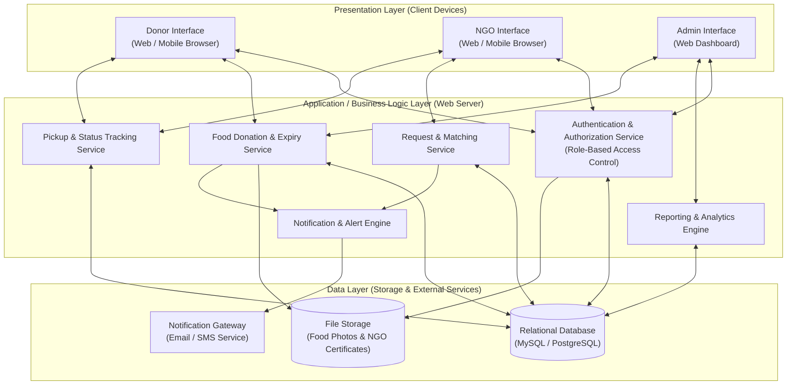
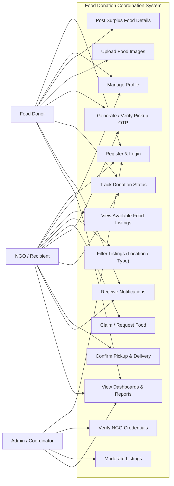
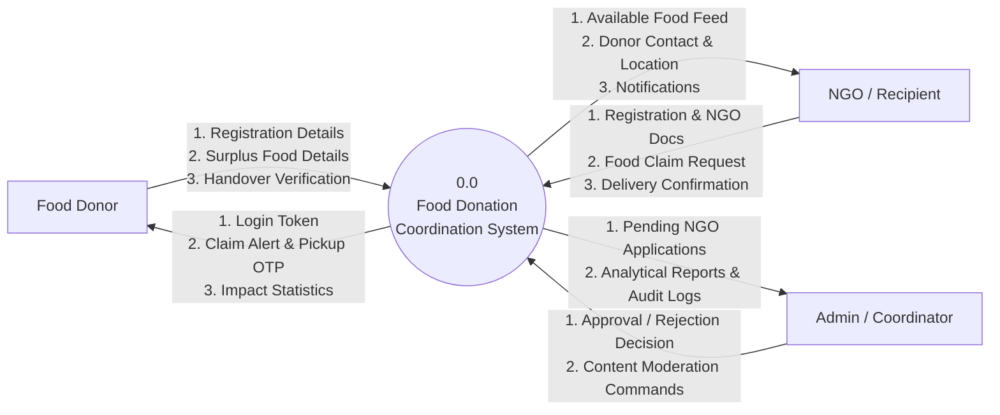
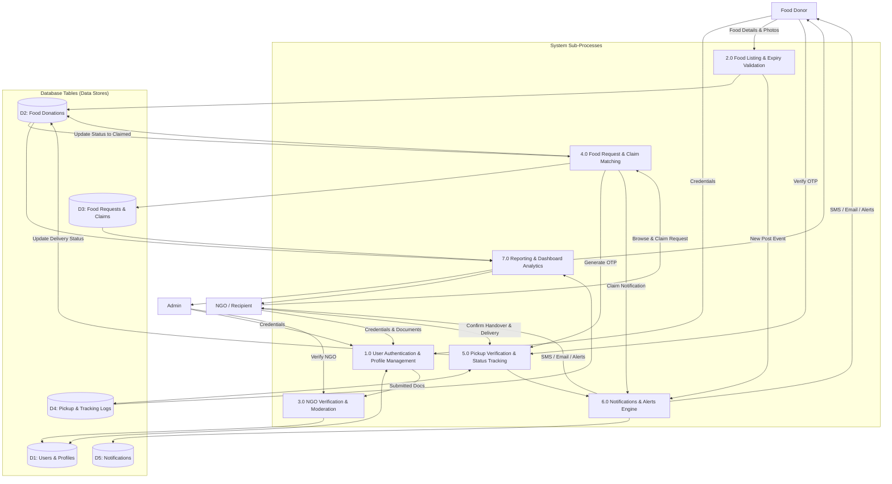
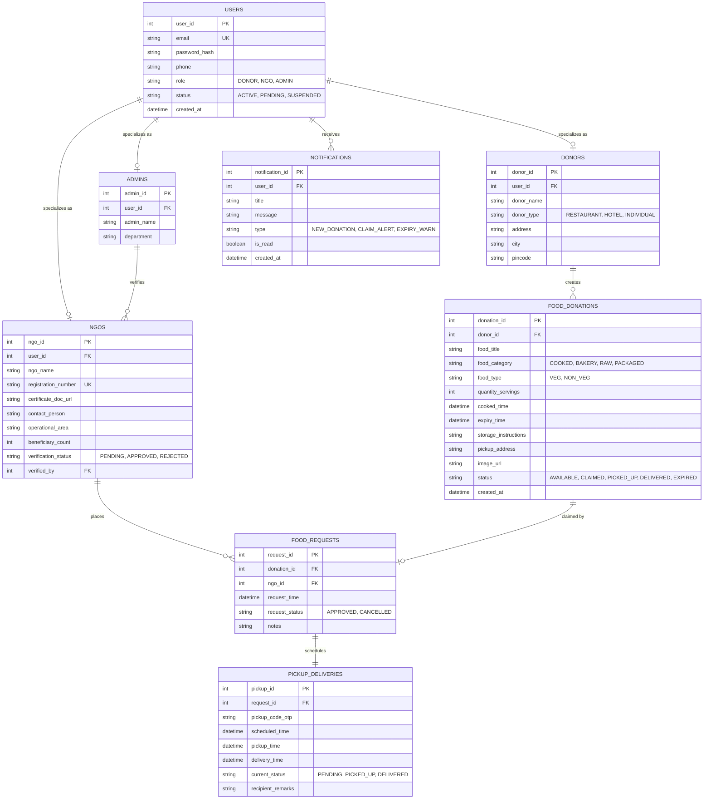
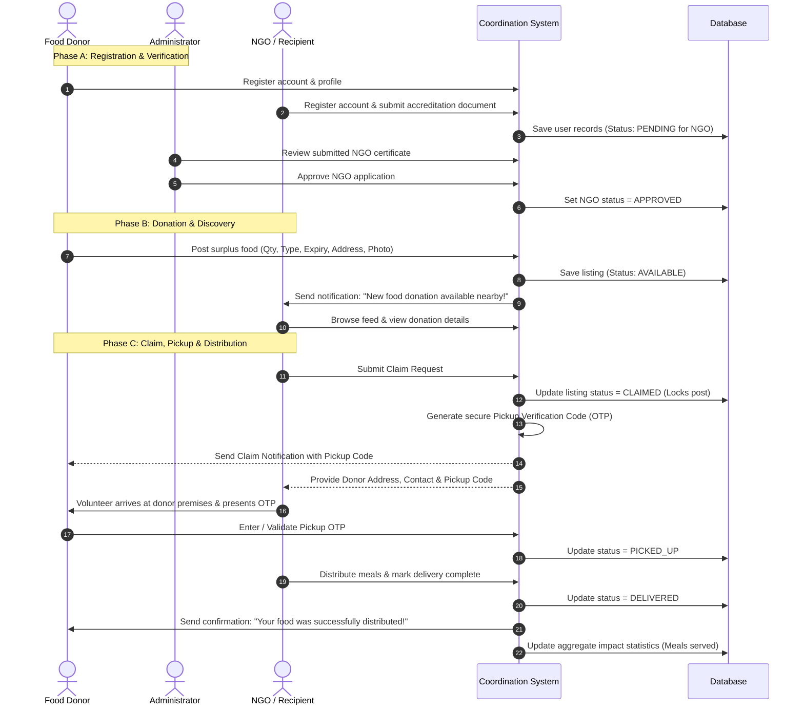

# FOOD DONATION COORDINATION SYSTEM
## Phase 2: System Design Document
**Academic Level:** Bachelor / Master of Computer Applications & Technology (BCA / B.Tech / MCA)  
**Document Type:** System Design Specification (SDS) - Phase 2  
**Project Domain:** Web Applications / Social Welfare & Resource Optimization  

---

## 1. System Architecture

### 1.1 Architectural Pattern: Three-Tier Architecture
The Food Donation Coordination System is designed using the industry-standard **Three-Tier (3-Tier) Architecture**. This separates the system into three distinct layers:
1. **Presentation Layer (Client Tier):** The user interface rendered in web browsers on laptops, tablets, or smartphones (HTML5, CSS3, JavaScript / Frontend framework).
2. **Application / Business Logic Layer (Server Tier):** The server-side application engine (e.g., Java / Spring Boot, Python / Django, or Node.js) that enforces business rules, validates food expiry, manages user roles, and handles matching and notifications.
3. **Data Layer (Database Tier):** The Relational Database Management System (e.g., MySQL / PostgreSQL) that securely stores user profiles, food listing details, claim records, transaction logs, and audit trails.

### 1.2 System Architecture Diagram



### 1.3 Component Interactions
* **Donor $\leftrightarrow$ Application Server:** The donor logs in, submits surplus food details with expiry time, uploads pictures, and confirms pickups using an OTP/verification code.
* **NGO $\leftrightarrow$ Application Server:** The NGO views nearby available donations, reserves a batch by placing a claim, coordinates pickup, and marks the donation as delivered to beneficiaries.
* **Admin $\leftrightarrow$ Application Server:** The admin reviews uploaded NGO registration documents, approves or suspends accounts, monitors active listings, and reviews analytics.
* **Application Server $\leftrightarrow$ Database:** All transactional queries (user validation, listing creation, status updates, history retrieval) are executed securely via structured SQL queries.
* **Notification Engine $\leftrightarrow$ Users:** Triggers real-time alerts to NGOs when food is posted in their area and alerts donors when food is claimed and collected.

---

## 2. System Modules

The system is partitioned into nine cohesive modules, each managing a specific functional area of the food donation lifecycle:

### 2.1 Donor Module
* **Account Registration & Login:** Allows individuals, hotels, caterers, and restaurants to create and maintain accounts.
* **Profile Management:** Stores donor business details, physical address, landmark, and primary contact number.
* **Donation History:** Displays a historical ledger of all past donations made by the donor with timestamps and receiving NGO details.

### 2.2 NGO / Recipient Module
* **Account Registration & Document Submission:** Allows charitable trusts, shelters, and orphanages to register and upload accreditation documents.
* **Profile & Capacity Settings:** Stores beneficiary count, vehicle/pickup capability, operating district, and authorized representative contacts.
* **My Claims Management:** Displays active food claims awaiting pickup, contact details of donors, and distribution history.

### 2.3 Admin / Coordinator Module
* **NGO Document Verification:** Secure dashboard for admins to examine uploaded certificates and approve or reject NGO applications.
* **Content Moderation:** Enables administrators to review and remove spoiled, duplicate, or inappropriate food posts.
* **User & System Management:** Tools to deactivate non-compliant accounts and manage operational parameters.

### 2.4 Food Donation Module
* **Add Surplus Food:** Captures food category, preparation time, quantity in servings/kg, shelf life/expiry time, packaging type, and photos.
* **Automated Expiry Scheduler:** Automatically calculates remaining shelf life; flags and deactivates listings that cross the expiry threshold.
* **Listing Management:** Allows donors to edit listing details or cancel an active donation before an NGO claims it.

### 2.5 Food Request & Claim Module
* **Search & Filter Engine:** Enables NGOs to filter active donations by location, dietary preference (Veg/Non-Veg), and quantity.
* **Instant Claim Lock:** Places an exclusive lock on an available listing upon claim submission to prevent race conditions (double claims).
* **Pickup Token / OTP Generation:** Automatically generates a shared 4-to-6 digit alphanumeric token between donor and claiming NGO for verification.

### 2.6 Pickup & Delivery Module
* **Logistics Coordination:** Displays pickup location, landmark, donor contact person, and navigation link to the NGO volunteer.
* **Handover Verification:** Validates the pickup code entered by the donor before handing over food packages.

### 2.7 Tracking Module
* **Status Lifecycle Progression:** Tracks status through five distinct milestones:
  $$\text{Posted} \longrightarrow \text{Claimed} \longrightarrow \text{Picked Up} \longrightarrow \text{Delivered} \quad (\text{or Expired / Cancelled})$$
* **Visual Progress Bar:** Renders a visual milestone stepper for both donor and recipient to monitor the transaction in real time.

### 2.8 Notification Module
* **New Donation Alert:** Dispatches immediate alerts to verified NGOs within the donor's district when new food is listed.
* **Urgent Expiry Alert:** Warns donors and nearby NGOs when an unclaimed listing is within 1 hour of its safe consumption limit.
* **Status Updates:** Notifies donors upon claim approval, driver arrival, and final distribution.

### 2.9 Reports & Dashboard Module
* **Donor Dashboard:** Summarizes total kilograms/servings donated, meals provided, and active contributions.
* **NGO Dashboard:** Displays active pickups, daily meals secured, and monthly beneficiary reach.
* **Admin Master Dashboard:** Generates aggregate analytics on total food saved, active participants, waste averted, and exportable PDF/Excel reports for compliance and audits.

---

## 3. Use Case Diagram

### 3.1 Actors and Descriptions
1. **Food Donor:** Creates surplus food listings, manages donation posts, and confirms handover.
2. **NGO / Recipient:** Searches food listings, claims available food, coordinates pickup, and marks distribution complete.
3. **Admin / Coordinator:** Verifies NGOs, moderates listings, manages platform users, and views system-wide analytics.

### 3.2 Use Case Diagram (Mermaid)



### 3.3 Actor-to-Use-Case Relationships

| Actor | Primary Use Cases | Relationship Description |
| :--- | :--- | :--- |
| **Donor** | Post Food, Upload Photos, Verify OTP, Track Status, View Impact | Donors interact with the system to publish available excess food, monitor the claim status, and verify the arriving volunteer using an OTP. |
| **NGO / Recipient** | Search Food, Claim Food, Coordinate Pickup, Confirm Delivery | NGOs explore listings, claim food suitable for their shelter capacity, navigate to the donor location, and confirm completion. |
| **Admin** | Verify NGO, Moderate Content, Manage Users, Generate Reports | Admins review uploaded NGO credentials, approve legitimate institutions, resolve disputes, and monitor system metrics. |

---

## 4. Data Flow Diagram (DFD)

### 4.1 Level 0 DFD (Context Diagram)
The Level 0 Context Diagram depicts the entire Food Donation Coordination System as a single central process interacting with external entities (Donor, NGO, Admin).



---

### 4.2 Level 1 DFD (Decomposed Functional Data Flow)
The Level 1 DFD decomposes the system into core sub-processes, showing how data moves between users, internal processes, and database stores.



---

## 5. Entity Relationship (ER) Diagram

### 5.1 Main Entities
1. **User:** Base entity storing login credentials and role definition.
2. **Donor:** Stores donor-specific information (business type, address, contact).
3. **NGO:** Stores charity-specific information (registration ID, certificate file, capacity).
4. **Admin:** Stores administrative roles and moderation logs.
5. **Food_Donation:** Stores surplus food records (quantity, shelf life, location, status).
6. **Food_Request:** Stores claim requests initiated by NGOs for specific donations.
7. **Pickup_Delivery:** Stores pickup logistics, OTP verification codes, and tracking progress.
8. **Notification:** Stores in-app alerts and notifications sent to users.

### 5.2 ER Diagram (Mermaid)



---

## 6. Database Design & Relational Schema

Below is the structured relational schema design with data types, primary keys (PK), foreign keys (FK), and business constraints.

### 6.1 Table: `users`
Stores primary authentication and identity details for all system actors.

| Column Name | Data Type | Key | Constraints / Description |
| :--- | :--- | :--- | :--- |
| `user_id` | `INT` | **PK** | `AUTO_INCREMENT`, Unique user identifier |
| `email` | `VARCHAR(100)` | **UK** | `NOT NULL`, `UNIQUE`, Used for login |
| `password_hash`| `VARCHAR(255)` | — | `NOT NULL`, BCrypt encrypted password string |
| `phone` | `VARCHAR(15)` | — | `NOT NULL`, Valid telephone number |
| `role` | `VARCHAR(20)` | — | `NOT NULL`, `CHECK(role IN ('DONOR', 'NGO', 'ADMIN'))` |
| `status` | `VARCHAR(20)` | — | `DEFAULT 'ACTIVE'`, `CHECK(status IN ('ACTIVE', 'PENDING', 'SUSPENDED'))` |
| `created_at` | `TIMESTAMP` | — | `DEFAULT CURRENT_TIMESTAMP` |

---

### 6.2 Table: `donors`
Stores organizational and address profiles for food donors.

| Column Name | Data Type | Key | Constraints / Description |
| :--- | :--- | :--- | :--- |
| `donor_id` | `INT` | **PK** | `AUTO_INCREMENT` |
| `user_id` | `INT` | **FK** | `NOT NULL`, References `users(user_id)` ON DELETE CASCADE |
| `donor_name` | `VARCHAR(120)` | — | `NOT NULL`, Name of restaurant, hotel, or individual |
| `donor_type` | `VARCHAR(30)` | — | `CHECK(donor_type IN ('RESTAURANT', 'HOTEL', 'CATERER', 'INDIVIDUAL'))` |
| `address` | `VARCHAR(255)` | — | `NOT NULL`, Physical pickup location |
| `city` | `VARCHAR(60)` | — | `NOT NULL`, City/District |
| `pincode` | `VARCHAR(10)` | — | `NOT NULL` |

---

### 6.3 Table: `ngos`
Stores institutional details, accreditation status, and documents of recipient charities.

| Column Name | Data Type | Key | Constraints / Description |
| :--- | :--- | :--- | :--- |
| `ngo_id` | `INT` | **PK** | `AUTO_INCREMENT` |
| `user_id` | `INT` | **FK** | `NOT NULL`, References `users(user_id)` ON DELETE CASCADE |
| `ngo_name` | `VARCHAR(150)` | — | `NOT NULL`, Registered charity name |
| `registration_no`| `VARCHAR(60)`| **UK** | `NOT NULL`, Unique government/charity registration ID |
| `certificate_url`| `VARCHAR(255)`| — | Path to uploaded verification document |
| `contact_person`| `VARCHAR(100)` | — | `NOT NULL`, Authorized volunteer/coordinator name |
| `operational_area`| `VARCHAR(100)`| — | City/Zone where NGO operates |
| `beneficiary_count`| `INT` | — | Average number of individuals supported |
| `verification_status`| `VARCHAR(20)`| — | `DEFAULT 'PENDING'`, `CHECK(status IN ('PENDING', 'APPROVED', 'REJECTED'))` |
| `verified_by` | `INT` | **FK** | Nullable, References `users(user_id)` |

---

### 6.4 Table: `admins`
Stores system administrator records.

| Column Name | Data Type | Key | Constraints / Description |
| :--- | :--- | :--- | :--- |
| `admin_id` | `INT` | **PK** | `AUTO_INCREMENT` |
| `user_id` | `INT` | **FK** | `NOT NULL`, References `users(user_id)` ON DELETE CASCADE |
| `admin_name` | `VARCHAR(100)` | — | Full name of administrator |
| `department` | `VARCHAR(80)` | — | Role / Department designation |

---

### 6.5 Table: `food_donations`
Stores every surplus food posting created by donors.

| Column Name | Data Type | Key | Constraints / Description |
| :--- | :--- | :--- | :--- |
| `donation_id` | `INT` | **PK** | `AUTO_INCREMENT` |
| `donor_id` | `INT` | **FK** | `NOT NULL`, References `donors(donor_id)` |
| `food_title` | `VARCHAR(120)` | — | `NOT NULL`, e.g., "Assorted Rice and Curry" |
| `food_category`| `VARCHAR(30)` | — | `CHECK(category IN ('COOKED', 'BAKERY', 'RAW', 'PACKAGED'))` |
| `food_type` | `VARCHAR(15)` | — | `CHECK(food_type IN ('VEG', 'NON_VEG'))` |
| `quantity` | `INT` | — | `NOT NULL`, Quantity in number of servings |
| `cooked_time` | `DATETIME` | — | `NOT NULL`, Timestamp when food was prepared |
| `expiry_time` | `DATETIME` | — | `NOT NULL`, Cutoff timestamp for safe consumption |
| `storage_type` | `VARCHAR(100)` | — | e.g., "Refrigerated", "Insulated stainless containers" |
| `pickup_address`| `VARCHAR(255)`| — | Specific pickup address with landmark |
| `image_url` | `VARCHAR(255)` | — | File path to food photograph |
| `status` | `VARCHAR(25)` | — | `DEFAULT 'AVAILABLE'`, `CHECK(status IN ('AVAILABLE', 'CLAIMED', 'PICKED_UP', 'DELIVERED', 'EXPIRED', 'CANCELLED'))` |
| `created_at` | `TIMESTAMP` | — | `DEFAULT CURRENT_TIMESTAMP` |

---

### 6.6 Table: `food_requests`
Maintains the mapping of an NGO claiming an available food donation.

| Column Name | Data Type | Key | Constraints / Description |
| :--- | :--- | :--- | :--- |
| `request_id` | `INT` | **PK** | `AUTO_INCREMENT` |
| `donation_id` | `INT` | **FK** | `NOT NULL`, References `food_donations(donation_id)` |
| `ngo_id` | `INT` | **FK** | `NOT NULL`, References `ngos(ngo_id)` |
| `request_time` | `TIMESTAMP` | — | `DEFAULT CURRENT_TIMESTAMP` |
| `request_status`| `VARCHAR(20)` | — | `DEFAULT 'APPROVED'`, `CHECK(status IN ('APPROVED', 'CANCELLED'))` |
| `notes` | `TEXT` | — | Optional notes (e.g., "Arriving with insulated van") |

---

### 6.7 Table: `pickup_deliveries`
Tracks the logistics, OTP verification, and status updates for an accepted donation.

| Column Name | Data Type | Key | Constraints / Description |
| :--- | :--- | :--- | :--- |
| `pickup_id` | `INT` | **PK** | `AUTO_INCREMENT` |
| `request_id` | `INT` | **FK** | `NOT NULL`, References `food_requests(request_id)` |
| `pickup_code_otp`| `VARCHAR(10)`| — | `NOT NULL`, Alphanumeric verification code |
| `scheduled_time`| `DATETIME` | — | Estimated volunteer arrival time |
| `pickup_time` | `DATETIME` | — | Actual handover timestamp |
| `delivery_time`| `DATETIME` | — | Distribution completion timestamp |
| `current_status`| `VARCHAR(25)` | — | `DEFAULT 'PENDING'`, `CHECK(current_status IN ('PENDING', 'PICKED_UP', 'DELIVERED'))` |
| `recipient_remarks`| `TEXT` | — | Comments on condition and distribution reach |

---

### 6.8 Table: `notifications`
Stores system alerts for all actors.

| Column Name | Data Type | Key | Constraints / Description |
| :--- | :--- | :--- | :--- |
| `notification_id`| `INT` | **PK** | `AUTO_INCREMENT` |
| `user_id` | `INT` | **FK** | `NOT NULL`, References `users(user_id)` ON DELETE CASCADE |
| `title` | `VARCHAR(100)` | — | `NOT NULL`, Short alert header |
| `message` | `TEXT` | — | `NOT NULL`, Detailed notification content |
| `type` | `VARCHAR(30)` | — | `CHECK(type IN ('NEW_DONATION', 'CLAIM_ALERT', 'EXPIRY_WARN', 'STATUS_UPDATE'))` |
| `is_read` | `BOOLEAN` | — | `DEFAULT FALSE` |
| `created_at` | `TIMESTAMP` | — | `DEFAULT CURRENT_TIMESTAMP` |

---

## 7. System Workflow

The complete end-to-end operational lifecycle follows an eight-stage sequential path:



### Detailed Workflow Stages
1. **Donor Registration:** The donor signs up, fills in address details, and gains immediate access to the donor dashboard.
2. **NGO Onboarding & Verification:** The NGO registers and uploads government-issued NGO registration documents. The administrator verifies the documents and activates the NGO account.
3. **Food Donation Posting:** A donor inputs details of surplus food (servings, cook time, expiry time, dietary type, photos).
4. **Automated Notification & Listing:** The system publishes the food post to the live feed and triggers alerts to all approved NGOs in the donor's district.
5. **NGO Claim & Single Lock:** An NGO clicks "Claim Food". The system sets the status to `CLAIMED`, removing it from the public view to prevent double allocation.
6. **Pickup Coordination & OTP Generation:** The system issues a 4-to-6 digit OTP. The NGO receives donor address navigation and direct contact information.
7. **Handover & Verification:** When the NGO arrives, the donor enters the volunteer's OTP into the portal. Upon match, status updates to `PICKED UP`.
8. **Delivery & Completion:** The NGO delivers food to beneficiaries and clicks "Mark as Distributed", closing the transaction and updating social impact metrics.

---

## 8. User Interface (UI) Design

The user interface is designed with simple, clear layouts tailored for fast operations across smartphones and desktop computers.

### 8.1 Food Donor Screens

| Screen Name | Layout Purpose & Features | Key UI Elements |
| :--- | :--- | :--- |
| **D-1: Donor Login & Registration** | Secure entry point for commercial and individual donors. | • Email, Password, Organization Name.<br>• Donor Type dropdown (Restaurant, Hotel, Individual).<br>• Address and contact number inputs. |
| **D-2: Donor Dashboard** | Primary hub showing real-time impact metrics and active posts. | • Impact summary cards: "Total Meals Donated", "Active Posts", "Kilograms Saved".<br>• Quick-action button: "+ Add New Surplus Food".<br>• Active donations card list with live status indicators. |
| **D-3: Add Surplus Food Screen** | Fast, intuitive form to list excess food in under 2 minutes. | • Food Item Name & Category selector.<br>• Veg / Non-Veg toggle.<br>• Quantity (Servings / kg) input.<br>• Cooked time & Expiry datetime pickers.<br>• Photo upload widget.<br>• Checkbox: "I confirm food is hygienically stored and safe". |
| **D-4: Donation Status & Handover Screen** | Real-time monitoring and pickup completion screen. | • Milestone progress stepper (`Available` $\rightarrow$ `Claimed` $\rightarrow$ `Picked Up` $\rightarrow$ `Delivered`).<br>• Claiming NGO details (Organization name, volunteer phone).<br>• "Enter Pickup OTP" input field with verification button. |
| **D-5: Donation History Screen** | Archival view of all past charitable contributions. | • Filterable table with dates, food items, quantity, recipient NGO name, and printable donation certificates. |

---

### 8.2 NGO / Recipient Screens

| Screen Name | Layout Purpose & Features | Key UI Elements |
| :--- | :--- | :--- |
| **N-1: NGO Registration Screen** | Onboarding screen requiring trust verification. | • Charity Registration Number.<br>• Certificate file uploader (PDF/JPEG).<br>• Shelter location and capacity (number of residents). |
| **N-2: NGO Dashboard** | Operational overview for the NGO coordinator. | • Summary cards: "Available Nearby", "Pending Pickups", "Meals Received This Month".<br>• Urgent alerts section for food expiring soon. |
| **N-3: Available Food Feed Screen** | Real-time browsing catalog of active food donations. | • Search bar and filter controls (Distance radius, Veg/Non-Veg, Quantity).<br>• Food cards displaying photos, remaining time countdown timer, quantity, and distance.<br>• "Claim Donation" action button. |
| **N-4: Active Pickup Coordination Screen** | Logistical guidance for volunteer drivers. | • Donor name, phone number, and address with "Open in Google Maps" button.<br>• Display of the unique **Pickup OTP** to show the donor.<br>• "Confirm Delivery to Beneficiaries" button upon completion. |
| **N-5: Distribution History Screen** | Detailed record of all food claimed and distributed. | • Historical log showing date, food source, volume collected, and notes for internal audits. |

---

### 8.3 Admin / Coordinator Screens

| Screen Name | Layout Purpose & Features | Key UI Elements |
| :--- | :--- | :--- |
| **A-1: Admin Master Dashboard** | High-level analytical view of system performance. | • Metric widgets: "Active Donors", "Verified NGOs", "Total Food Saved (kg)", "Pending Verifications".<br>• Graphical charts showing monthly donation trends and food waste reduction curves. |
| **A-2: NGO Verification Portal** | Review list for approving or declining charitable trusts. | • List of pending NGO applications with registration numbers.<br>• Document viewer to inspect accreditation certificates.<br>• "Approve Account" (Green) and "Reject with Reason" (Red) buttons. |
| **A-3: Donation Monitoring Screen** | Moderation interface for all active and completed listings. | • Master list of all postings with status filters (`Available`, `Claimed`, `Expired`).<br>• "Remove Listing" button for spam or unsafe entries. |
| **A-4: Reports & Analytics Generator** | Export tools for official reporting and analysis. | • Date-range selector (Daily, Monthly, Annual).<br>• Category-wise food distribution breakdowns.<br>• "Export PDF Report" and "Export CSV / Excel" buttons. |

---

## 9. Security Design

The system implements security-by-design principles appropriate for web-based social service platforms:

```
[ Incoming Request ]
         |
         v
[ HTTPS / SSL Transport Layer ]
         |
         v
[ Input Sanitization & CSRF / SQLi Protection ]
         |
         v
[ Authentication Filter (Session / JWT Token) ]
         |
         v
[ Role-Based Access Control (RBAC) Interceptor ]
         |
   +-----+-----+-----+
   |           |     |
[Donor]      [NGO] [Admin]
```

### 9.1 Authentication & Session Management
* **Secure Login:** Users authenticate using email and password. Sessions are maintained via secure HTTP-only cookies or JSON Web Tokens (JWT).
* **Automatic Session Timeout:** User sessions automatically expire after 30 minutes of inactivity to protect shared terminals in offices and shelters.

### 9.2 Role-Based Access Control (RBAC)
* Access permissions are strictly enforced on every backend route:
  * **Donors** can only invoke donation-creation, status-checking, and profile-management endpoints.
  * **NGOs** can only access food-browsing, claim-creation, and delivery-completion endpoints.
  * **Admins** hold exclusive access to user verification, moderation, and system-wide reports.

### 9.3 Password Hashing & Sensitive Data Protection
* **Cryptographic Hashing:** Passwords are never stored in plaintext. They are salted and hashed using **BCrypt** with a minimum work factor of 10.
* **Address Masking:** Donor street addresses and personal phone numbers are masked on public feeds. Only after an NGO places a confirmed claim are pickup coordinates revealed.

### 9.4 Input Validation & Sanitization
* **Client-Side Validation:** Immediate UI feedback for required fields, valid phone numbers, and future expiry dates.
* **Server-Side Validation:** All incoming request payloads are strictly validated and sanitized to prevent:
  * **SQL Injection (SQLi):** Enforced using Parameterized Queries / Prepared Statements (or ORM frameworks).
  * **Cross-Site Scripting (XSS):** All user text inputs (titles, instructions) are HTML-escaped before display.
  * **File Upload Restrictions:** Uploaded images and documents are restricted to valid extensions (`.jpg`, `.png`, `.pdf`) and limited to a maximum file size of 2 MB.

---

## 10. Design Summary & Alignment with Phase 1

The Phase 2 System Design directly translates all business, operational, and user requirements identified in Phase 1 into concrete technical blueprints:

1. **Solving Coordination Latency:** The combination of automated notification dispatch, real-time availability feeds, and single-allocation locks reduces matching time from hours to minutes.
2. **Preventing Spoilage:** The automated expiry validation logic and remaining-time timers directly address the perishable nature of cooked food.
3. **Ensuring Safety & Authenticity:** The administrative NGO verification portal and mutual OTP pickup verification prevent food theft, resale, or unauthorized claims.
4. **Providing Transparency:** The status tracking lifecycle (`Available` $\rightarrow$ `Claimed` $\rightarrow$ `Picked Up` $\rightarrow$ `Distributed`) provides complete operational visibility to all stakeholders.
5. **Architectural Feasibility:** The 3-Tier architecture and relational database schema provide a clean, modular foundation that can be implemented cleanly in standard college environments (such as Java Spring Boot / JSP, Node.js Express, or Python Django with MySQL).
