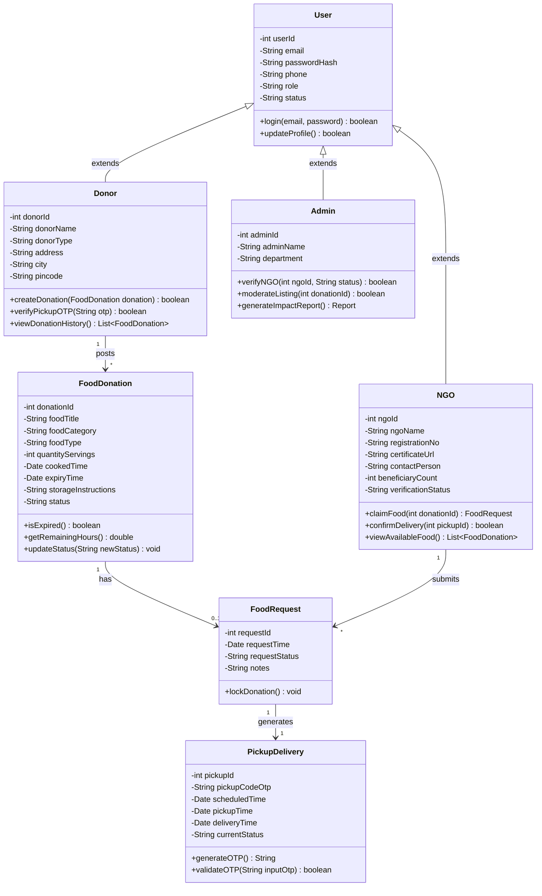

# FOOD DONATION COORDINATION SYSTEM
## Phase 3: Implementation Plan, Database Scripts & Detailed Specifications
**Academic Level:** Bachelor / Master of Computer Applications & Technology (BCA / B.Tech / MCA)  
**Document Type:** Technical Specification & Database Implementation Guide  
**Project Domain:** Web Applications / Social Welfare & Resource Optimization  

---

## 1. Technology Stack Selection

For a college project (BCA / B.Tech / MCA), the system is built with a proven, robust, and industry-standard technology stack that is easy to demonstrate in a college lab and evaluate during a viva/project presentation:

| Layer | Recommended Technology | Alternative College Options | Justification |
| :--- | :--- | :--- | :--- |
| **Frontend (UI)** | **HTML5, CSS3, JavaScript, Bootstrap 5** | React.js, Tailwind CSS | Fast rendering, responsive across mobile and desktop, zero complex build setups. |
| **Backend (Logic)**| **Java (Spring Boot / Jakarta EE Servlets)** | Node.js (Express), Python (Django/Flask) | Strong type-safety, robust OOP principles, built-in security, standard for college evaluations. |
| **Database** | **MySQL 8.0+** | PostgreSQL 13+ | Widely taught in university curriculums, ACID compliant, reliable relational joins. |
| **ORM / Data Access** | **Spring Data JPA / Hibernate (or JDBC)** | Sequelize / Mongoose | Automates CRUD operations, prevents SQL injection via parameterized queries. |
| **Tools & IDE** | **Eclipse IDE / IntelliJ IDEA / VS Code** | NetBeans | Seamless database tooling, embedded Tomcat server support. |
| **API Testing** | **Postman** | Thunder Client / Browser Fetch | Easy demonstration of REST endpoints during project evaluation. |

---

## 2. Complete Database DDL SQL Scripts

Below is the complete, ready-to-execute SQL script to initialize the database, create tables with all constraints, and insert initial seed data for testing and demonstration.

```sql
-- ==============================================================
-- DATABASE CREATION
-- ==============================================================
CREATE DATABASE IF NOT EXISTS food_donation_db;
USE food_donation_db;

-- --------------------------------------------------------------
-- 1. TABLE: USERS (Base Authentication Table)
-- --------------------------------------------------------------
CREATE TABLE IF NOT EXISTS users (
    user_id INT AUTO_INCREMENT PRIMARY KEY,
    email VARCHAR(100) NOT NULL UNIQUE,
    password_hash VARCHAR(255) NOT NULL,
    phone VARCHAR(15) NOT NULL,
    role ENUM('DONOR', 'NGO', 'ADMIN') NOT NULL,
    status ENUM('ACTIVE', 'PENDING', 'SUSPENDED') DEFAULT 'ACTIVE',
    created_at TIMESTAMP DEFAULT CURRENT_TIMESTAMP
) ENGINE=InnoDB;

-- --------------------------------------------------------------
-- 2. TABLE: DONORS (Donor Profiles)
-- --------------------------------------------------------------
CREATE TABLE IF NOT EXISTS donors (
    donor_id INT AUTO_INCREMENT PRIMARY KEY,
    user_id INT NOT NULL,
    donor_name VARCHAR(120) NOT NULL,
    donor_type ENUM('RESTAURANT', 'HOTEL', 'CATERER', 'INDIVIDUAL') NOT NULL,
    address VARCHAR(255) NOT NULL,
    city VARCHAR(60) NOT NULL,
    pincode VARCHAR(10) NOT NULL,
    FOREIGN KEY (user_id) REFERENCES users(user_id) ON DELETE CASCADE
) ENGINE=InnoDB;

-- --------------------------------------------------------------
-- 3. TABLE: NGOS (NGO & Recipient Profiles)
-- --------------------------------------------------------------
CREATE TABLE IF NOT EXISTS ngos (
    ngo_id INT AUTO_INCREMENT PRIMARY KEY,
    user_id INT NOT NULL,
    ngo_name VARCHAR(150) NOT NULL,
    registration_no VARCHAR(60) NOT NULL UNIQUE,
    certificate_url VARCHAR(255),
    contact_person VARCHAR(100) NOT NULL,
    operational_area VARCHAR(100) NOT NULL,
    beneficiary_count INT DEFAULT 0,
    verification_status ENUM('PENDING', 'APPROVED', 'REJECTED') DEFAULT 'PENDING',
    verified_by INT NULL,
    FOREIGN KEY (user_id) REFERENCES users(user_id) ON DELETE CASCADE,
    FOREIGN KEY (verified_by) REFERENCES users(user_id) ON DELETE SET NULL
) ENGINE=InnoDB;

-- --------------------------------------------------------------
-- 4. TABLE: ADMINS (Administrator Profiles)
-- --------------------------------------------------------------
CREATE TABLE IF NOT EXISTS admins (
    admin_id INT AUTO_INCREMENT PRIMARY KEY,
    user_id INT NOT NULL,
    admin_name VARCHAR(100) NOT NULL,
    department VARCHAR(80) NOT NULL,
    FOREIGN KEY (user_id) REFERENCES users(user_id) ON DELETE CASCADE
) ENGINE=InnoDB;

-- --------------------------------------------------------------
-- 5. TABLE: FOOD_DONATIONS (Surplus Food Postings)
-- --------------------------------------------------------------
CREATE TABLE IF NOT EXISTS food_donations (
    donation_id INT AUTO_INCREMENT PRIMARY KEY,
    donor_id INT NOT NULL,
    food_title VARCHAR(120) NOT NULL,
    food_category ENUM('COOKED', 'BAKERY', 'RAW', 'PACKAGED') NOT NULL,
    food_type ENUM('VEG', 'NON_VEG') NOT NULL,
    quantity_servings INT NOT NULL,
    cooked_time DATETIME NOT NULL,
    expiry_time DATETIME NOT NULL,
    storage_instructions VARCHAR(150),
    pickup_address VARCHAR(255) NOT NULL,
    image_url VARCHAR(255),
    status ENUM('AVAILABLE', 'CLAIMED', 'PICKED_UP', 'DELIVERED', 'EXPIRED', 'CANCELLED') DEFAULT 'AVAILABLE',
    created_at TIMESTAMP DEFAULT CURRENT_TIMESTAMP,
    FOREIGN KEY (donor_id) REFERENCES donors(donor_id) ON DELETE CASCADE
) ENGINE=InnoDB;

-- --------------------------------------------------------------
-- 6. TABLE: FOOD_REQUESTS (NGO Claims)
-- --------------------------------------------------------------
CREATE TABLE IF NOT EXISTS food_requests (
    request_id INT AUTO_INCREMENT PRIMARY KEY,
    donation_id INT NOT NULL,
    ngo_id INT NOT NULL,
    request_time TIMESTAMP DEFAULT CURRENT_TIMESTAMP,
    request_status ENUM('APPROVED', 'CANCELLED') DEFAULT 'APPROVED',
    notes TEXT,
    FOREIGN KEY (donation_id) REFERENCES food_donations(donation_id) ON DELETE CASCADE,
    FOREIGN KEY (ngo_id) REFERENCES ngos(ngo_id) ON DELETE CASCADE
) ENGINE=InnoDB;

-- --------------------------------------------------------------
-- 7. TABLE: PICKUP_DELIVERIES (Logistics & OTP Handover)
-- --------------------------------------------------------------
CREATE TABLE IF NOT EXISTS pickup_deliveries (
    pickup_id INT AUTO_INCREMENT PRIMARY KEY,
    request_id INT NOT NULL,
    pickup_code_otp VARCHAR(10) NOT NULL,
    scheduled_time DATETIME,
    pickup_time DATETIME NULL,
    delivery_time DATETIME NULL,
    current_status ENUM('PENDING', 'PICKED_UP', 'DELIVERED') DEFAULT 'PENDING',
    recipient_remarks TEXT,
    FOREIGN KEY (request_id) REFERENCES food_requests(request_id) ON DELETE CASCADE
) ENGINE=InnoDB;

-- --------------------------------------------------------------
-- 8. TABLE: NOTIFICATIONS (System Alerts)
-- --------------------------------------------------------------
CREATE TABLE IF NOT EXISTS notifications (
    notification_id INT AUTO_INCREMENT PRIMARY KEY,
    user_id INT NOT NULL,
    title VARCHAR(100) NOT NULL,
    message TEXT NOT NULL,
    type ENUM('NEW_DONATION', 'CLAIM_ALERT', 'EXPIRY_WARN', 'STATUS_UPDATE') NOT NULL,
    is_read BOOLEAN DEFAULT FALSE,
    created_at TIMESTAMP DEFAULT CURRENT_TIMESTAMP,
    FOREIGN KEY (user_id) REFERENCES users(user_id) ON DELETE CASCADE
) ENGINE=InnoDB;

-- ==============================================================
-- SAMPLE SEED DATA FOR DEMO & TESTING
-- ==============================================================
-- 1. Insert Users (Password: 'password123' hashed with bcrypt)
INSERT INTO users (email, password_hash, phone, role, status) VALUES
('admin@foodrescue.org', '$2a$10$7EqJtq98hPqEX7fNZaFWoO.8Hw48X3i6MvPqkI7V6jU44d18zZc/q', '9876543210', 'ADMIN', 'ACTIVE'),
('taj.hotel@hospitality.com', '$2a$10$7EqJtq98hPqEX7fNZaFWoO.8Hw48X3i6MvPqkI7V6jU44d18zZc/q', '9811122233', 'DONOR', 'ACTIVE'),
('hope.shelter@charity.org', '$2a$10$7EqJtq98hPqEX7fNZaFWoO.8Hw48X3i6MvPqkI7V6jU44d18zZc/q', '9822233344', 'NGO', 'ACTIVE');

-- 2. Insert Profiles
INSERT INTO admins (user_id, admin_name, department) VALUES
(1, 'System Administrator', 'Operations & Verification');

INSERT INTO donors (user_id, donor_name, donor_type, address, city, pincode) VALUES
(2, 'The Grand Taj Hotel', 'HOTEL', '45 Central Avenue, Near Civic Center', 'Bangalore', '560001');

INSERT INTO ngos (user_id, ngo_name, registration_no, certificate_url, contact_person, operational_area, beneficiary_count, verification_status, verified_by) VALUES
(3, 'Hope Orphanage & Shelter', 'NGO-BLR-2024-8891', 'uploads/certs/ngo_8891.pdf', 'Sister Maria / Rajesh', 'Central & South Bangalore', 120, 'APPROVED', 1);

-- 3. Insert Food Listing
INSERT INTO food_donations (donor_id, food_title, food_category, food_type, quantity_servings, cooked_time, expiry_time, storage_instructions, pickup_address, status) VALUES
(1, 'Steamed Basmati Rice & Mixed Dal Curry', 'COOKED', 'VEG', 80, NOW(), DATE_ADD(NOW(), INTERVAL 5 HOUR), 'Stored in clean insulated containers at 60C', '45 Central Avenue, Kitchen Gate No 2', 'AVAILABLE');
```

---

## 3. Class Diagram & Object-Oriented Design



---

## 4. UI Wireframes & Layout Mockups

### 4.1 Donor Dashboard & Add Food Wireframe

```
+------------------------------------------------------------------------------------+
|  FOOD RESCUE PORTAL        [Dashboard]  [My Donations]  [Profile]       [Logout]   |
+------------------------------------------------------------------------------------+
|  Welcome, The Grand Taj Hotel!                                                    |
|                                                                                    |
|  +----------------------+  +----------------------+  +-------------------------+   |
|  |  TOTAL DONATED       |  |  MEALS PROVIDED      |  |  ACTIVE POSTS           |   |
|  |     1,240 kg         |  |     3,100 Servings   |  |     2 Active            |   |
|  +----------------------+  +----------------------+  +-------------------------+   |
|                                                                                    |
|  +------------------------------------------------------------------------------+  |
|  | + ADD NEW SURPLUS FOOD                                                       |  |
|  |------------------------------------------------------------------------------|  |
|  | Food Title:      [ Steamed Rice & Veg Korma                      ]          |  |
|  | Category:        [( ) Cooked  ( ) Bakery  ( ) Packaged           ]          |  |
|  | Type:            [(X) Pure Veg       ( ) Non-Veg                 ]          |  |
|  | Quantity:        [ 60 ] Servings / Approx [ 25 ] kg                         |  |
|  | Cooked Time:     [ 2026-10-05 12:30 PM ]                                    |  |
|  | Safe Until:      [ 2026-10-05 06:30 PM ] (Calculated shelf life: 6 hrs)     |  |
|  | Storage:         [ Kept in hot insulated containers              ]          |  |
|  | Pickup Address:  [ Gate 2, Hotel Taj, MG Road                    ]          |  |
|  | Photo:           [ Choose File: rice_curry.jpg                   ]          |  |
|  | [X] I declare that the food is clean, hygienic, and safe for consumption.     |  |
|  |                                                                              |  |
|  |                  [ CANCEL ]          [ SUBMIT DONATION ]                     |  |
|  +------------------------------------------------------------------------------+  |
+------------------------------------------------------------------------------------+
```

---

### 4.2 NGO Food Feed & Claim Wireframe

```
+------------------------------------------------------------------------------------+
|  FOOD RESCUE PORTAL        [Browse Food]  [My Pickups]  [History]       [Logout]   |
+------------------------------------------------------------------------------------+
|  Available Surplus Food Nearby                                                     |
|  Filters: [ All Distance v ]  [ Veg Only v ]  [ Min 50 Servings v ]   [Apply]     |
|                                                                                    |
|  +------------------------------------------------------------------------------+  |
|  | [PHOTO]  Steamed Basmati Rice & Mixed Dal Curry                              |  |
|  |          Donor: The Grand Taj Hotel (1.8 km away)                            |  |
|  |          Dietary: [VEG] | Quantity: 80 Servings                              |  |
|  |          Cooked: 1:00 PM | Safe Until: 6:30 PM                               |  |
|  |          STATUS: [AVAILABLE]  *** EXPIRING IN 3 HOURS 15 MINS ***            |  |
|  |                                                                              |  |
|  |          [ VIEW LOCATION DETAILS ]                  [ CLAIM THIS FOOD ]      |  |
|  +------------------------------------------------------------------------------+  |
|                                                                                    |
|  +------------------------------------------------------------------------------+  |
|  | [PHOTO]  Fresh Bread Loaves & Assorted Croissants                            |  |
|  |          Donor: Royal Bakers (3.4 km away)                                   |  |
|  |          Dietary: [VEG] | Quantity: 40 Servings                              |  |
|  |          STATUS: [AVAILABLE]  *** EXPIRING IN 6 HOURS ***                    |  |
|  |                                                                              |  |
|  |          [ VIEW LOCATION DETAILS ]                  [ CLAIM THIS FOOD ]      |  |
|  +------------------------------------------------------------------------------+  |
+------------------------------------------------------------------------------------+
```

---

### 4.3 Handover Verification Modal (OTP Verification)

```
+--------------------------------------------------------------------+
|                      HANDOVER VERIFICATION                         |
|--------------------------------------------------------------------|
|  Claiming Organization: Hope Orphanage & Shelter                   |
|  Assigned Volunteer:    Rajesh Kumar (+91 98222 33344)             |
|  Item:                  Basmati Rice & Dal (80 Servings)           |
|                                                                    |
|  Ask the volunteer for their 4-digit pickup code:                  |
|                                                                    |
|                         [ 8 ] [ 4 ] [ 2 ] [ 1 ]                    |
|                                                                    |
|  [!] Check food containers before handing over.                    |
|                                                                    |
|          [ CLOSE ]              [ VERIFY & CONFIRM HANDOVER ]      |
+--------------------------------------------------------------------+
```

---

## 5. REST API Specifications

The backend service exposes standard RESTful endpoints consumed by the web client:

### 5.1 Authentication Endpoints
* `POST /api/auth/register` $\rightarrow$ Registers new Donor or NGO.
* `POST /api/auth/login` $\rightarrow$ Validates credentials and returns JWT token or creates HTTP-only session.
* `GET  /api/auth/me` $\rightarrow$ Returns logged-in user profile and role.

### 5.2 Food Donation Endpoints
* `POST /api/donations` $\rightarrow$ Creates new surplus food post (Donor only).
* `GET  /api/donations/active` $\rightarrow$ Lists all unclaimed, unexpired food items (NGOs and Admins).
* `GET  /api/donations/{id}` $\rightarrow$ Returns detailed info of a single donation.
* `PUT  /api/donations/{id}/cancel` $\rightarrow$ Cancels donation listing before claim (Donor only).

### 5.3 Request & Coordination Endpoints
* `POST /api/requests/claim` $\rightarrow$ NGO submits claim for a `donation_id`. Returns pickup code & donor details.
* `POST /api/deliveries/verify-otp` $\rightarrow$ Donor enters OTP; upon match, status changes to `PICKED_UP`.
* `PUT  /api/deliveries/{id}/complete` $\rightarrow$ NGO volunteer marks distribution complete to beneficiaries.

### 5.4 Administrative Endpoints
* `GET  /api/admin/ngos/pending` $\rightarrow$ Returns list of unverified NGOs with certificate links.
* `PUT  /api/admin/ngos/{id}/verify` $\rightarrow$ Approves or rejects NGO account.
* `GET  /api/admin/stats` $\rightarrow$ Returns summary numbers (food saved, total meals, active users).

---

## 6. Core Business Logic & Algorithms

### 6.1 Automated Expiry Calculation Algorithm
When a donor submits a food post, the system enforces safe shelf-life constraints:

$$\text{Shelf Life Hours} = \frac{\text{Expiry Time} - \text{Cooked Time}}{3600 \text{ seconds}}$$

* **Rule 1:** $\text{Expiry Time} > \text{Current Time} + 30 \text{ minutes}$ (Reject if less than 30 mins remaining).
* **Rule 2:** For cooked meals, maximum allowed shelf life without cold chain refrigeration is **8 hours**.
* **Scheduled Background Job:** A cron job runs every 10 minutes:
  $$\text{UPDATE food\_donations SET status = 'EXPIRED' WHERE status = 'AVAILABLE' AND expiry\_time < NOW()}$$

### 6.2 Proximity Matching (Haversine Distance Formula)
To filter food listings by distance between donor coordinates $(lat_1, lon_1)$ and NGO coordinates $(lat_2, lon_2)$:

$$d = 2R \cdot \arcsin\left(\sqrt{\sin^2\left(\frac{\Delta lat}{2}\right) + \cos(lat_1)\cos(lat_2)\sin^2\left(\frac{\Delta lon}{2}\right)}\right)$$

Where $R = 6371 \text{ km}$ (Earth's radius).

### 6.3 Secure 4-Digit Pickup OTP Generation
```java
// Pseudo-code for OTP Generation
public String generatePickupOTP() {
    java.security.SecureRandom random = new java.security.SecureRandom();
    int code = 1000 + random.nextInt(9000); // Guarantees a 4-digit number
    return String.valueOf(code);
}
```

---

## 7. Testing Strategy (Preview for Phase 4)

To ensure system reliability before college viva presentation:

1. **Unit Testing:** Testing individual methods (e.g., OTP validation, expiry date validator).
2. **Integration Testing:** Testing flow from food post $\rightarrow$ database save $\rightarrow$ notification alert.
3. **Double-Claim Prevention Test:** Simulating two concurrent NGOs attempting to claim the same donation at the same millisecond to prove database transaction locking.
4. **Role Security Test:** Verifying that an NGO cannot access `/admin` or `/api/donations/create`.
